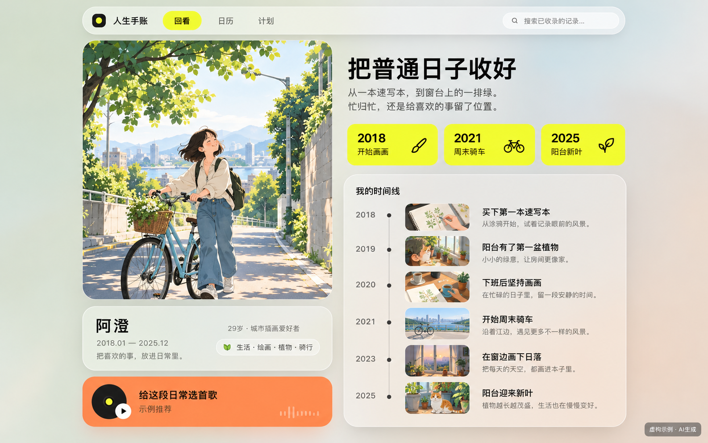
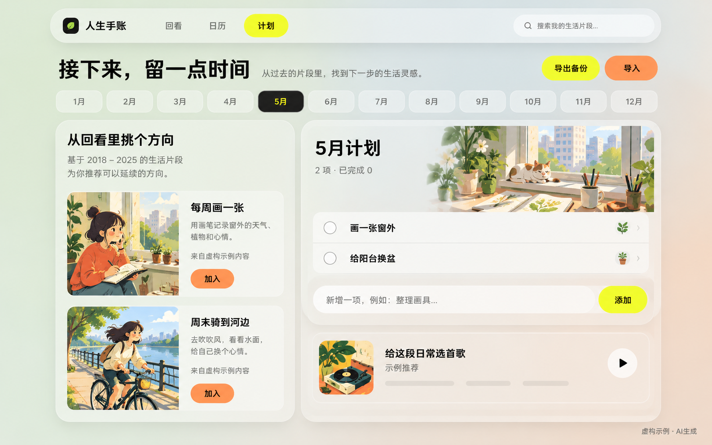

<p align="center">
  
</p>

<h1 align="center">微博人生手账</h1>
<p align="center">把分散的微博记录，整理成一本能翻阅、搜索、回到原文的生活手账。</p>
<p align="center"><strong>Agent Skill</strong> · 原创图文 · 完整 / 精选 · 本地离线</p>
<p align="center">
  <a href="#快速开始">快速开始</a> ·
  <a href="#两种视觉方向">效果预览</a> ·
  <a href="SKILL.md">查看 Skill</a> ·
  <a href="https://github.com/fly-YaoPro/weibo-life-archive/archive/refs/heads/main.zip">下载完整包</a>
</p>

> 这是给 Agent 使用的一套指令、参考图和本地检查工具，不是安装即运行的网站或现成爬虫。下方图片是 **AI 生成的虚构设计示意**，不是用户数据或端到端实测截图。

## 做出来是什么

| 回看 | 日历档案 | 后续计划 |
| --- | --- | --- |
| 从真实记录里找生活变化，组织短总结、主题页与歌曲推荐。 | 点日期看原文和大图，跨年份搜索，结论可回查来源。 | 把有依据的方向放进月份，自己修改、打卡，导出备份。 |

最终产物是一份独立的静态网页文件夹。核心浏览、搜索与计划应能离线使用；打开原微博等外链仍需要网络。

## 两种视觉方向

### 01 / 珊瑚红纸质手账

明亮的红色封套、奶白纸、相纸和便签，用纵向活页环组织阅读。实际记录中的照片保留真实影像，不转换成卡通。


<details>
<summary>展开查看主题页与分享版式</summary>


<p align="center"></p>

</details>

### 02 / 现代磨砂手账

低饱和底色、半透明面板，搭配黄橙高亮。保留清晰的影像、短总结和日期节点，不套复古纸张。



<details>
<summary>展开查看日历与计划版式</summary>




</details>

## 快速开始

1. 下载完整仓库，保留 `SKILL.md`、`references/`、`assets/` 和 `scripts/` 的相对位置。
2. 将完整文件夹交给支持本地 `SKILL.md` 的 Agent，或放进该客户端规定的 Skill 目录。具体加载入口以客户端为准。
3. Agent 需要文件读写、代码执行和本地读图能力；在线采集还需要浏览器操作能力。已有合法导出时可以直接制作，不必重新采集。

**可以直接这样说：**

```text
使用这个 Skill，把我提供的微博主页整理成人生手账。
时间范围先看近十年，采用珊瑚红纸质风格。
先轻量检查工作量，让我选完整归档还是每年精选，再继续。
设计前打开 Skill 里的参考图；正文和照片全部使用真实记录。
```

也可以给已有数据，只说“保留我的资料和手动计划，换成磨砂风格”。更多用法见 [调用示例](references/usage.md)。

### 采集前，先选工作量

| 模式 | 保存什么 | 适合什么情况 |
| --- | --- | --- |
| 完整归档 | 日期范围内尽量全部可访问的原创图文，缺口单独说明。 | 更看重保存完整资料，愿意等待。 |
| 精选回看 | 按年份、月份分散选择，默认每年约 30 条，可调 20—50 条。 | 内容很多，先把有代表性的生活片段整理出来。 |

精选不等于随意截取最近几页，也不代表完整十年。找到早期记录有时仍需顺序翻页，不能保证跳过这部分时间。

## 两条不能混淆的规则

**参考图要真的看。** Agent 在设计前打开相应本地图片，提炼配色、材质、构图、字体层级和留白，再与实际页面截图对照。只有文字说明不够；无法读图时要说明限制。

**真实素材不能生成。** 示例人物、照片、日期和文案全部虚构。正式手账必须使用目标微博的真实平台图片或用户授权的真实资料，不能拿 AI 图、卡通图或图库照片补成“历史记录”。缺图就标记缺图，用真实原文排版。装饰性贴纸可以另做。

## 工作方式

```text
确认目标与范围 → 小样本核验 → 选择完整 / 精选
                         ↓
真实记录与图片 → 有据回看 → 看参考图并制作网页 → 离线与交互验收
```

- 微博主页可编辑，不内置真实账号；登录者不自动成为采集目标。
- 只读取正常权限内可见的原创图文，默认排除转发与视频。
- 长文补全文，多图核对数量；中断保存进度，后续可以继续补采。
- 歌曲是有依据的推荐，不把推荐写成本人“最爱”，不自动播放或下载音源。
- 标题、日期范围和计划年份可改，不绑定固定活动名或年份。

## 本地检查

检查器使用 **Python 3.9+ 标准库**，不联网，不读取登录态。

```bash
# 在 Skill 目录中运行；“项目目录”是生成的手账目录，不是 Skill 本身
python scripts/check_project.py "项目目录" --kind weibo --stage data
python scripts/check_project.py "项目目录" --kind weibo --stage final

# 合成数据回归测试，不碰真实账号
python -B scripts/test_check_project.py
```

结构检查通过不等于正文真实、采集全量或交互可用。浏览器还要实测 `file://` 离线、搜索、日历定位、计划备份恢复和 PNG 导出，未测项必须说明。详见 [验收清单](references/acceptance.md)。

## 仓库结构

```text
SKILL.md          Agent 入口
agents/           可选的客户端展示信息
references/       采集、数据格式、内容、视觉与验收规则
assets/cases/     虚构视觉参考图
assets/provenance.json  参考图说明与校验值
scripts/          本地结构检查与合成数据测试
```

## 隐私与发布边界

登录和验证码由用户完成；不绕过访问限制。Cookie、令牌、浏览器 profile、真实导出和用户图片不进入这个公开仓库。生成的手账默认只留本地，分享图默认隐藏账号、私人照片与原入口，不自动上传或公开部署。

平台页面和接口可能变化；本仓库不保证固定接口永久可用，也不承诺未经实测的完成时间。公开版已做结构、链接、素材替换及离线合成数据检查，**未据此宣称真实账号端到端验证通过**。

---

[作者：fly-YaoPro](https://github.com/fly-YaoPro) · [姊妹 Skill：淘宝消费手账](https://github.com/fly-YaoPro/taobao-consumption-journal)

本仓库未附加开源许可证；复用与再分发授权请先联系作者。使用平台内容时仍需遵守相应权限与权利边界。
